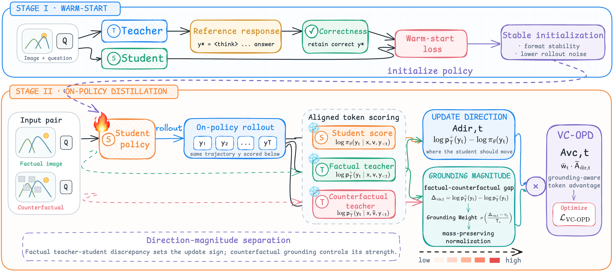

# VC-OPD: Visual Counterfactual On-Policy Distillation for Grounded Vision-Language Reasoning

> ***Grounding-aware on-policy distillation for image-dependent reasoning.***

## Overview

**VC-OPD** is a grounding-aware on-policy distillation method for vision-language reasoning. It preserves dense teacher supervision on student-generated trajectories while prioritizing tokens whose correctness depends on image-specific evidence.

Standard on-policy distillation measures where a student disagrees with a teacher, but does not distinguish visually grounded content from generic reasoning phrases or language-prior continuations. VC-OPD addresses this by scoring the same student trajectory with a teacher under both the original image and a counterfactual image with weakened instance-specific visual evidence.

  

  <em>The factual teacher determines the update direction; counterfactual visual grounding controls the update strength.</em>

## Release Status

**Code coming soon.** This repository currently contains only the project introduction and framework figure. The implementation will be uploaded in a future update.
